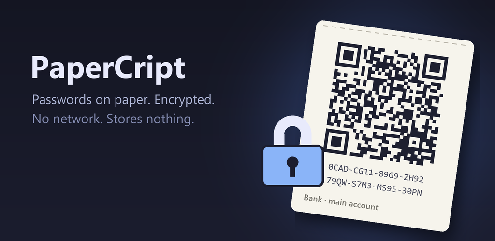
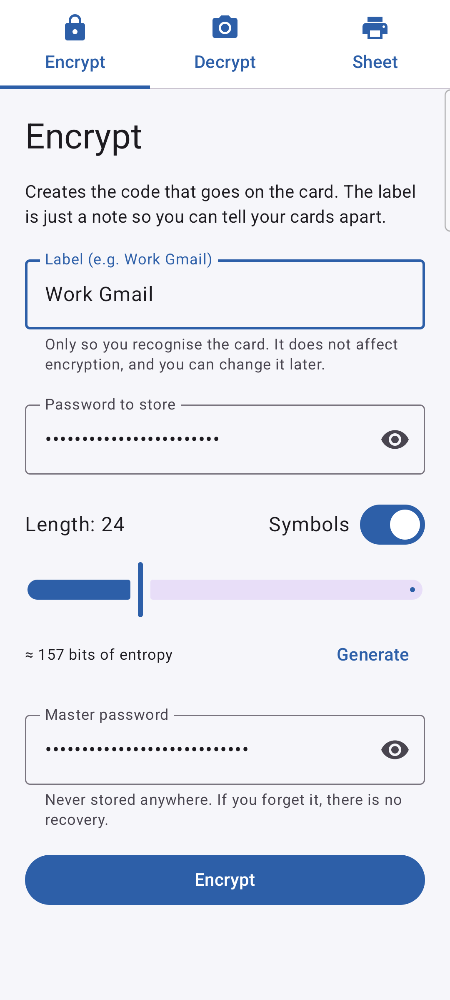
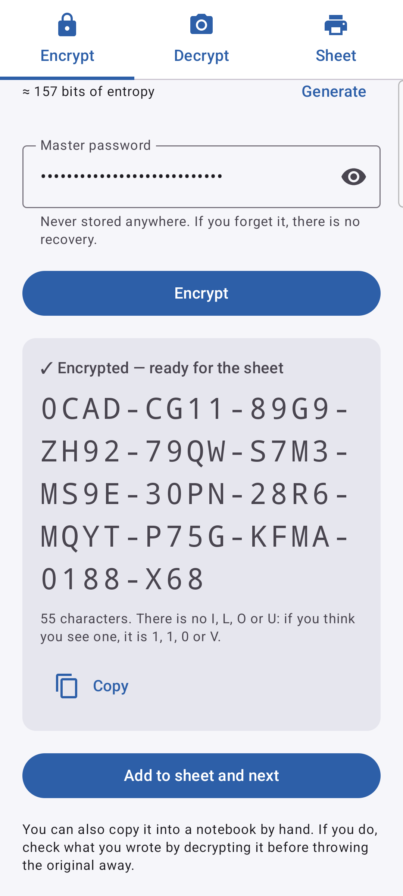
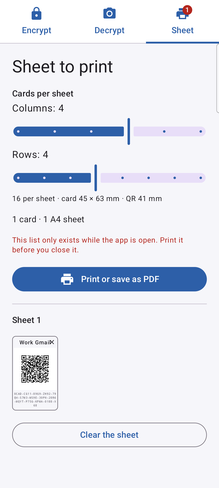

# PaperCript

<p align="center"><a href="README.md">English</a> · Español</p>

<p align="center">
  
</p>
<p align="center">
  
  
  
</p>

App de Android que guarda tus contraseñas **en papel, cifradas**.

Cifras una contraseña con tu clave maestra, la app la convierte en una tarjeta con un código QR
e imprimes una hoja A4 de tarjetas recortables. Para recuperar una contraseña, escaneas su QR y
escribes la clave maestra.

La gracia es que **perder el papel no te cuesta nada**: una tarjeta no vale nada sin la clave
maestra. Guárdalas en un cajón, repártelas o deja una copia en casa de un amigo.

La app no guarda nada: ni contraseñas, ni la clave maestra, ni historial. El papel es el único
almacenamiento.

## Instalar

- **[F-Droid](https://f-droid.org/packages/com.javimetallab.papercript/)**: busca *PaperCript* en
  la app de F-Droid (o en Droid-ify, Neo Store…); ella la mantiene al día.
- **APK** de la [última versión](https://github.com/javimentallab/PaperCript/releases/latest).
  F-Droid la compila de forma reproducible y distribuye este mismo APK firmado, así que puedes
  cambiar de una fuente a otra y seguir actualizando.

---

## Cómo se usa

**Cifrar** → etiqueta, contraseña (escrita o generada) y clave maestra → *Cifrar* → *Añadir a la
hoja y siguiente*. La clave maestra se conserva entre entradas para que puedas encadenar varias de golpe.

**Hoja** → elige columnas y filas, mira cómo quedará la página y pulsa *Imprimir o guardar en PDF*.
El diálogo de impresión de Android sirve tanto para una impresora de verdad como para un PDF. Luego
recórtalas.

**Descifrar** → *Escanear el QR de la tarjeta* → clave maestra. La etiqueta viaja dentro del QR, así
que solo tienes que escribir la clave maestra.

> ⚠️ La lista de tarjetas pendientes solo existe en memoria mientras la app está abierta. Imprime
> antes de cerrarla.

> ⚠️ La clave maestra no se puede recuperar. Si la olvidas, todas las tarjetas impresas se convierten
> en papel para reciclar, todas a la vez.

## La hoja

Eliges la disposición (de 1 a 6 columnas × de 1 a 8 filas) y la app te dice el tamaño real en
milímetros de la tarjeta y del QR. Menos tarjetas por folio significa un QR más grande y más fácil
de escanear. Por debajo de unos 18 mm de QR avisa, porque ahí cada módulo baja de 0,45 mm y las
cámaras de los móviles empiezan a sufrir.

Cada tarjeta lleva la etiqueta, el QR y el código en letra pequeña. Ese texto impreso es el plan de
rescate si un QR se estropea: se vuelve a escribir en la app con un teclado de 32 teclas que solo
ofrece caracteres válidos.

## Formato del código

```
[ versión 1B ][ salt 4B ][ texto cifrado NB ][ etiqueta 5B ]
```

Todo en Base32 estilo Crockford, un alfabeto **sin I, L, O ni U** para que no se confundan con 1, 1,
0 y V al teclear.

- **Derivación de la clave**: `scrypt(clave_maestra, dominio + versión + salt)` → 64 bytes, repartidos
  en una clave de cifrado y una de MAC. La v3 usa N=65536 (64 MB), más o menos un segundo por operación
  en un móvil actual.
- **Cifrado**: AES-256-CTR con un IV fijo. Es seguro porque el salt es aleatorio en cada cifrado, así
  que la clave nunca se repite y nunca se reutiliza un flujo de clave.
- **Integridad**: HMAC-SHA256 truncado a 40 bits, cifrar y luego autenticar. Detecta a la vez un
  carácter mal escrito y una clave maestra equivocada, y por eso un fallo no puede decirte cuál de
  los dos ha sido.
- **La etiqueta no entra en la derivación.** Es tu propia nota: cámbiala o escríbela mal sin romper la
  tarjeta.
- **El byte de versión selecciona los parámetros**, así que subir el coste más adelante no invalida
  lo que ya está impreso.

El QR contiene `LBR1|código|etiqueta` con corrección de errores de nivel Q (aguanta hasta un 25 % de
daño), porque estas tarjetas se doblan y se manosean.

> ⚠️ **La cadena de dominio y los parámetros quedan congelados** desde la primera tarjeta que imprimes.
> La clave nunca se guarda: se recalcula entera en cada descifrado. Cambiar cualquier ingrediente deja
> las tarjetas ya emitidas ilegibles para siempre.

## Seguridad

**Ya es poscuántica**, sin esfuerzo: todo aquí es simétrico (scrypt, AES-256, HMAC-SHA256). El algoritmo
de Shor rompe RSA y las curvas elípticas, y ninguno de los dos aparece en esta app; Grover solo baja
AES-256 a unos 128 bits efectivos, muy lejos de cualquier alcance. El verdadero eslabón débil es la
entropía de tu clave maestra: una frase aleatoria de 6 o 7 palabras (77–90 bits) es lo que de verdad
cambia las cosas.

**Lo que hace la app:**

- **Sin permiso de red.** El APK solo declara `CAMERA`, e `INTERNET` se elimina expresamente con
  `tools:node="remove"`. Sin él, el kernel no deja a la app abrir un socket: no es una promesa, es una
  incapacidad.
- **Código abierto entero.** Los QR se leen con [ZXing](https://github.com/zxing/zxing); no hay Google
  Play Services ni otras bibliotecas propietarias.
- `FLAG_SECURE`: sin capturas de pantalla, sin miniatura en recientes y sin grabación de pantalla.
- El portapapeles se marca como sensible y se borra a los 45 s de copiar **o al volver a la app**, lo
  que ocurra con ella en primer plano. También hay un botón para borrarlo en el acto.
- Sin copias de seguridad (`allowBackup=false`) y sin escribir nada en disco.
- Las claves derivadas se ponen a cero en memoria en cuanto se usan.
- **Política de privacidad dentro de la app**: un botón al final de la pestaña Cifrar la muestra como
  texto, en tu idioma, así que leerla no necesita red. También está en [PRIVACY](PRIVACY.md), en inglés.

**Lo que no cubre, y deberías saber:**

- Un **servicio de accesibilidad** malicioso puede leer lo que hay en pantalla. `FLAG_SECURE` no lo
  impide. Este es el agujero más real.
- Tu **teclado** ve todo lo que escribes, incluida la clave maestra. Es inherente a Android.
- **Ninguna app puede borrar el portapapeles desde segundo plano.** Desde Android 10 el sistema niega
  el acceso a quien no tenga el foco (`Denying clipboard access ... application is not in focus`), así
  que un temporizador que salta mientras pegas en otro sitio no borra nada. De ahí el borrado al volver
  y el botón manual. Si no vuelves nunca a la app, la contraseña se queda ahí hasta que el sistema la
  limpie.
- La longitud del código revela la longitud de la contraseña.

**Nada de esto lo ha auditado nadie de fuera.** Es criptografía estándar montada con cuidado, pero haz
el ciclo completo con una contraseña de usar y tirar antes de confiarle una de verdad.

## Idiomas

Dieciocho idiomas, con las 70 cadenas traducibles completas en todos: **inglés** (el predeterminado),
**castellano, catalán, gallego, euskera, francés, alemán, italiano, portugués, neerlandés, polaco, ruso,
ucraniano, chino simplificado, japonés, coreano, tailandés e hindi**.

La app sigue el idioma del móvil y, para cualquier otro, usa el inglés. En Android 13+ declara
`localeConfig`, así que puedes fijar un idioma solo para PaperCript en **Ajustes → Aplicaciones →
PaperCript → Idioma**, sin tocar el sistema.

> Las traducciones no las ha revisado ningún nativo. Si algo suena mal, es un fichero de texto:
> arreglarlo no toca el código.

**Para añadir un idioma**, copia `res/values/strings.xml` a `res/values-xx/`, tradúcelo y añade
`<locale android:name="xx" />` a `res/xml/locales_config.xml`. Sin tocar Kotlin.

Luego comprueba que el idioma nuevo cuadra:

```
pwsh tools/check-locales.ps1
```

Verifica que no falte ni sobre ninguna clave y que los especificadores de formato (`%1$d`, `%2$s`…)
coincidan con los del inglés. Esto último importa más de lo que parece: un `%1$s` traducido como `%1$d`
compila sin problemas y revienta al formatear, delante del usuario.

En chino y japonés, **cada cadena debe ir en una sola línea**. Android une las líneas partidas con un
espacio, que en idiomas sin separadores de palabras cae en mitad de una frase.

## Compilar

```
./gradlew testDebugUnitTest assembleDebug
```

El APK queda en `app/build/outputs/apk/debug/`. Para uso real, compila una release firmada con tu propio
almacén de claves.

Requiere JDK 21 y Android SDK 36. Sin dependencias de red en tiempo de ejecución.

## Contribuir

Consulta [CONTRIBUTING](CONTRIBUTING.md), en inglés. Para avisar en privado de un problema de seguridad, consulta [SECURITY](SECURITY.md).

## Licencia

[MIT](LICENSE) © [javimentallab](https://github.com/javimentallab). Las licencias de terceros están en
[NOTICE](NOTICE).
